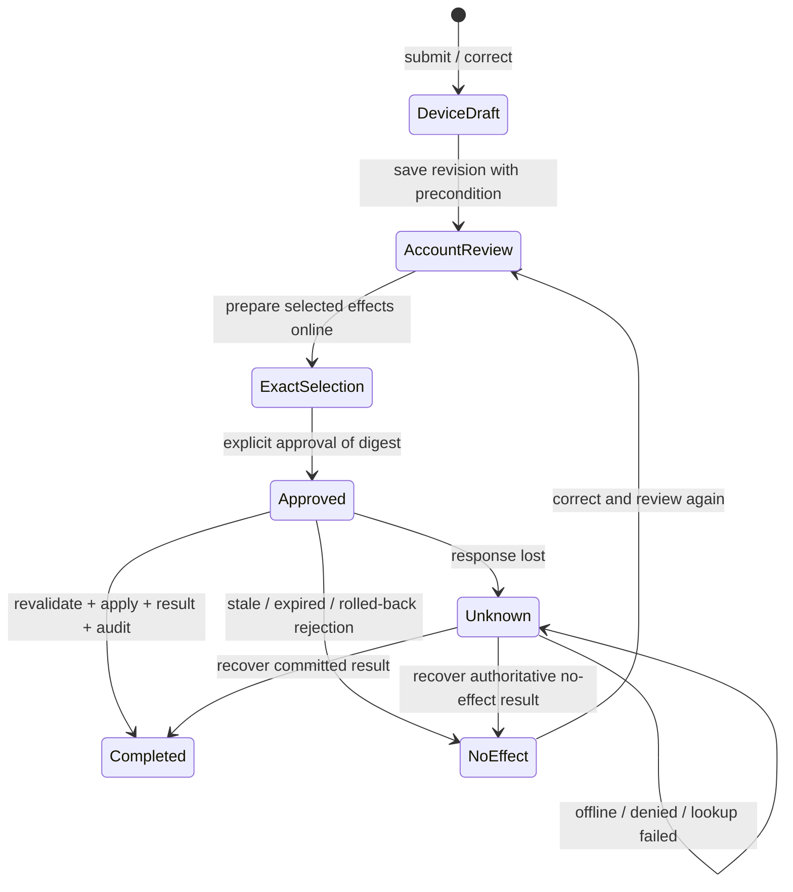

# Stage 1: durable review and approved stock receiving

16 November 2026. Integrated with upstream `f622cfe` through merge `1f5a196`.
This is an internal Smart Intake increment, not the complete first release.
The Assistant entry, newer invoice/PO and insight comparisons, new-product path
and manual stock workflows are preserved.

## The new boundary

Corrected reviews are saved to the account as well as scoped IndexedDB.
The server prepares exact selected effects: quantities, destination, buying cost,
stock before/after and calculated average cost. Explicit approval binds the
revision, digest, actor, expiry and material dependencies. Execution accepts only
approval and row references; the browser cannot replace approved business fields.

The canonical runtime contract is
[stock-review-contract.ts](../../src/lib/ai/stock-review-contract.ts).
The new migration is
[20261116080912_ai_stock_review_approvals.sql](../../supabase/migrations/20261116080912_ai_stock_review_approvals.sql).
It depends on existing purchase-cost, AI plumbing/Owner access and both
15 November AI receipt/new-product migrations. Fetching Git does not deploy SQL.
Inspect the target schema/history before applying dependencies.

## Merchant flow

1. Reopen unfinished work, or submit input through the existing Assistant.
   Existing reviews are checked before spending another generation.
2. Correct rows. Typing saves to this device; finishing a field saves to the
   account. Failure remains visible; a stale tab cannot silently overwrite a
   newer account revision.
3. Select ready rows, confirm physical receipt and review server-calculated
   effects. Existing products keep their selling price. New products require
   name, SKU, supported unit and explicit selling price.
4. Explicitly approve that selection. Selection is not approval; approval is
   not completion.
5. The server rechecks current Owner, organisation, entitlement, revision,
   expiry, product, warehouse, stock and valuation within the execution
   transaction. Changed facts produce a durable no-effect result.
6. Each item's effects and durable result commit together. Successful independent
   rows remain saved while other rows are repaired.
7. After a lost response, check the original operation. Retry retains its identity.
   A missing, denied or failed lookup never proves nothing happened.

## Permission, source and recovery guarantees

- API, RPC and direct-table policies require the current active Business Owner.
  Account precondition headers reject session switches; they grant no authority.
  Tenant and nested-resource scope remain server-derived.
- Original text/CSV and normalised spreadsheet text are retained privately with
  fingerprints. Original XLSX binaries are not retained. Images/audio retain
  fingerprints only; the review states original media is unavailable.
  Source text, filename metadata and transcripts are excluded from revised
  job/suggestion audit copies. Production retention remains a decision.
- All approved operations remain discoverable by exact selection after later
  revisions. Corrections invalidate old unexecuted selections. Confirmed outcomes
  remain immutable and recoverable after expiry or plan loss.
- Legacy public AI receipt writers allow matching-result replay only. Private
  base writers are unavailable to browser roles. Ledger tables are SELECT-only
  under RLS.
- Whole base quantities and two-decimal known costs are enforced. Missing cost
  remains unresolved. Explicit incoming zero is supported; positive existing
  stock with zero valuation requires separate valuation review.
- Preview and the domain receipt share average-cost arithmetic. All locations
  affect average cost; displayed stock identifies the selected destination.
  New product plus first receipt is atomic.
- Apply requires online checks. No competing inventory snapshot or generic
  offline stock queue is introduced. Offline review is device-saved work.
- Unresolved approvals cannot be discarded by closing a review. Cancelling an
  in-flight request does not reverse its possible server effect.

## Explicit expiry policy

Stock review approvals default to 600 seconds when the organisation has no
`ai_stock_review_ttl_seconds` setting. An explicit setting can override this
with 60 to 3,600 seconds. Invalid overrides block preview. The forward migration
must be applied for the default to take effect. Fresh wall-clock checks follow
potentially blocking locks. Expiry prevents first execution. The owner can still
check the result of an earlier attempt after expiry.

## Concurrency trade-off

The current boundary takes an organisation row lock before job/product locks and
locks relevant inventory. Product parent locks also guard new inventory-location
inserts through foreign keys. This conservative policy can serialize same-business
activity, including status reads. Manual helpers may acquire locks in another
order. Native multi-session checks must establish observed blocking and rollback;
PGlite alone cannot prove concurrency or production throughput. Narrower shared
locking requires a separately reviewed change.

## Verification and remaining gates

Verified so far on this branch:

- The selected regression set passed 155 tests across 16 files, including the
  page, launcher, invoice comparison, draft/cache, receiving UI, AI APIs and
  database tests. One cold notification-fixture timeout was rerun successfully
  after increasing only its bootstrap-inclusive budget. TypeScript passed.
  The final typed API changes were checked again with 24 focused tests, including
  two new analytics record-validation cases (included in the 155 total).
  Changed TypeScript/TSX lint, tracked-environment hygiene and diff checks passed.
  The full Next.js 16.2.12 Webpack production build passed, including all 71
  page-generation tasks. It used a temporary single-worker setting and 1,280 MB
  heap cap; the original Next configuration was restored. The build's generated
  route checks exposed an optional GET parameter, which was corrected and its
  focused tests rerun before this successful build.
- 40 new database cases and 18 stock-review API cases passed. The fixtures load
  the actual purchase-cost, receipt, new-product and approval migrations; they
  do not replace the domain receipt with a success stub.
  Browser testing exposed Next's internal-host normalisation rejecting a genuine
  loopback Origin. The check now compares the actual Host, protocol and port,
  ignores forwarded-host overrides and rejects malformed/foreign origins. Five
  additional cases passed; independent read-only security review found no blocker.
  Missing-Origin non-browser clients retain authenticated API compatibility. This
  exception is not a claim of complete CSRF protection; deployment proxies must
  preserve external Host/protocol or use an explicitly trusted origin policy.
- A separate native PostgreSQL 18.1 harness proved real lock waits using
  `pg_stat_activity` and `pg_blocking_pids`. Five scenarios covered manual stock
  update, manual costed receipt, new-location insertion/product FK locking,
  concurrent same-approval retries, and a deliberate deadlock. Stale effects
  were refused, retries produced one receipt, and the deadlock victim rolled
  back. Actual sale/transfer endpoints and throughput remain separate gates.
- The required migrations were rehearsed only on authorised disposable project
  `jtqyxfoyllcvptxgwhmk`, then those four exact versions were registered with
  `supabase migration repair --status applied`. The project's older baseline
  history was absent: this does not establish full migration-history parity or
  authorise replaying all other migrations.
  Hosted grant checks confirmed browser-role private writer execution, selection
  INSERT and receipt TRUNCATE are denied, and receipt RLS is enabled.
- A normal authenticated synthetic QA Owner used the hosted RPC boundary to
  reserve a controlled job, save/restore its correction, preview, approve, execute,
  replay, recover the durable result and close. Destination stock changed from
  13 to 15 once; average cost was 111.11 and matched the server preview. The
  600-second TTL was configured only for that synthetic QA organisation. No
  subscription or paid entitlement was fabricated and no provider was called.
- The built HTTP API recovered the same receipt with normal Owner cookies,
  rejected a mismatched account (409) and rejected a raw unapproved write (400).
  Headless Chrome then uploaded an actual synthetic CSV, changed quantity 2 to
  3 and saved it to the account. Independent hosted reads before approval found
  zero products/receipts and review revision 1 containing quantity 3. The exact
  preview showed stock 0 → 3, buying cost 150 and selling price 200. After the
  explicit approval, the UI showed **Stock saved** and linked the product.
  Independent reads found one product, stock 3, cost 150, selling price 200, one
  receipt, one cost-history row and a completed operation. Reload retained the
  confirmed state. At a 390-pixel viewport the document width was also 390 pixels
  (no horizontal overflow in this check). The job was
  `f65bc533-8d88-4089-9b33-6c18759764ce`. This is controlled browser evidence,
  not real merchant/device usability or live document-understanding evidence.

Controlled fixtures do not establish provider extraction accuracy, merchant
usability or production deployment. The earlier failed Vercel preview's build
logs are unavailable to this account and the product owner; its cause and
preview acceptance remain unverified.

The test environment also showed a missing `record_merchant_app_open` RPC (404)
and an intermittent subscription-verification HTTP 503. They remain recorded
environment limitations; this increment does not repair unrelated schema or
claim that every application workflow passed.

Stage 1 remains partly implemented until wider migration/schema parity, actual
sale/transfer/PO contention, device/accessibility and merchant review have
acceptance evidence. Accepted Free/other-paid eligibility
also exceeds the existing introductory/Growth guard and needs scoped work.

All first-release inputs remain required: text/messages, CSV/Excel, printed
invoice photos/PDFs, other photos and handwriting. This increment does not
complete PDF handling, all-format/provider accuracy, source-to-line evidence,
pack conversion, bulk setup, shared physical-delivery lineage, atomic PO partial
receiving, memo composition or sourced price suggestions. Job/row idempotency
does not prevent receiving the same physical delivery through a different job.
These need bounded follow-ups and their own acceptance evidence.

## Gemini and local price pilot configuration

Select `AI_PROVIDER=gemini` with a server-side `GEMINI_API_KEY` and a supported
`GEMINI_MODEL`. The adapter defaults to `gemini-3.8-flash`. The synthetic
invoice was also tested with `gemini-3.5-flash-lite`. Use `AI_PROVIDER=mock`
for tests that do not need real extraction. The Assistant advertises photo and
audio capabilities from the configured adapter.

Local price search stays unavailable unless `AI_LOCAL_PRICE_FEEDS` contains
approved retailer feeds. Each entry declares `seller`, `url`, and
`approved: true`. Use an HTTPS JSON feed whose publisher permits processing and
display in Track Kasuwa. The feed receives only the canonical state. Its
`offers` supply the product identity, variant and pack, seller area,
`priceMinor` in NGN, availability, retail terms, store or pickup fulfilment,
product link and source observation time. The service validates these fields
and only returns comparable offers in the confirmed area.

The separate price approval migration supports existing-product receipts.
Leave `AI_PRICE_WRITES_ENABLED=false` during rollout. An offline product
snapshot can carry an old price, and an offline Cashier sale captured before
an online price change can still encounter the current-price discount guard.
Both two-device cases must pass before enabling Assistant price writes.
