# Stage 1: saved review and receipt recovery

Baseline: upstream `f147635` (15 November 2026). This is an internal Smart Intake
increment, not the complete first release. The existing Assistant entry, latest
launcher/UI changes, new-product intake and manual stock workflows are preserved.

## Current upstream foundation

Upstream now supplies `/api/ai/stock-receipts` and the
`20261115120000_ai_stock_intake_receipts.sql` /
`20261115130000_ai_new_product_intake.sql` migrations. These check the active
Business Owner, AI entitlement, organisation and ready job. They bind receipt
identity to `(job_id, row_index)`, record effects and audit information, and reject
changed effects on replay. New-product creation and its first receipt share the
server transaction. Source code is evidence of these mechanisms, not proof that
the migrations have been deployed to a particular hosted project.

This change uses that API. It does not call the generic stock writer or introduce
another stock queue, receipt RPC or migration.

## Merchant behaviour

- A generated review is saved in the existing account-specific IndexedDB
  `app_meta` store, additionally keyed by organisation and Owner.
- Reloading preserves row corrections, new-product details, buying costs,
  selling prices and outcomes. Selection and the review confirmation reset.
- The older browser-wide `trackasuwa.ai.stockJob` pointer can be adopted only
  after its existing server endpoint authorises access. A network failure does
  not delete that pointer; it presents a retry state before new work can begin.
- Unmatched rows retain upstream's new-product path. New products require a
  name, SKU, supported unit and explicit selling price. Existing products retain
  their selling price. Unknown buying cost stays unresolved; genuinely free
  stock requires explicit zero-cost confirmation.
- New approvals require a resolved destination and online connectivity. Missing
  catalog data prevents approval while saved attempts remain available for checks.
- Before dispatch, the exact selected row command is durably saved. All inputs
  and replacement controls lock during execution; an attempted row is immutable.
- A timeout or failed response means confirmation pending. It does not produce
  an optimistic stock delta or enter the manual offline queue.
- Check receipt status performs a read. Only a matching server result establishes
  completion. Missing, denied or failed lookup remains unconfirmed. An explicit
  retry checks first and sends the same job, row and frozen effects.
- A review with unresolved attempts cannot be closed or replaced. Completed
  receipts remain recorded when the review is closed; unattempted rows are discarded.

## Concurrency and account isolation

Scoped storage transactions use a revision comparison so an older tab cannot
overwrite a newer review. Session/namespace checks surround asynchronous work;
switching Owner, organisation, role or account namespace stops later dispatches
and prevents late responses from updating another account's review. The server
also binds the original job to its Owner, so the current session cannot execute
another Owner's job. An already dispatched operation may still commit: retain its
original identity and recover its outcome.

Only mapped source fields and corrected commands are stored, not original photos,
recordings, files or credentials. Browser storage failure blocks submission.
Clearing browser storage can remove local corrections and recovery references;
these are device-local drafts, not permanent or cross-device backups.

```mermaid
stateDiagram-v2
  [*] --> Draft: save mapped review on this device
  Draft --> Pending: Owner reviews and applies / persist exact command
  Pending --> Saved: server confirms matching effects
  Pending --> Pending: no confirmation / check or explicit same-command retry
  Saved --> [*]: close review; recorded stock is retained
```

## Verification and remaining boundaries

Tests cover IndexedDB reload/CAS/storage failure, immutable attempts, wrong
account/role, missing receipt evidence, offline submission prevention, locked
in-flight rows, new-product review, legacy-job recovery and existing server-confirmed
rows. Existing upstream AI/database regressions are checked separately.

Controlled tests do not establish production deployment, real Owner usability,
provider extraction accuracy or a full release gate. The installed upstream
receipt migrations remain a deployment prerequisite; this PR does not apply them.
Local drafts are not a server-persisted pre-execution proposal revision or approval
digest. Those stronger cross-device/stale-dependency semantics remain future work.
An unresolved rejected attempt stays locked until its result can be reconciled;
the UI does not infer that an unsuccessful response proves no prior effect.

All accepted first-release inputs remain required: text/messages, CSV/Excel,
printed invoice photos/PDFs, other photos and handwriting. Document/provider
accuracy, delivery duplicate detection, PO/partial-receipt reconciliation,
memo lineage, unit/pack modelling and sourced price suggestions need their own
bounded implementation and evaluation. This recovery increment does not claim
those capabilities are complete.

Validation on this change: 101 tests passed across 11 files (AI tests, review/page/
launcher DOM tests and purchase-cost database tests); TypeScript, lint for the six
changed TypeScript files, tracked-environment hygiene and diff checks passed.
`npm run build -- --webpack` completed, including 70 page-generation tasks. The
4 GB laptop build used a temporary single-worker override and a 1280 MB JavaScript
heap cap; that override was restored. Build-only dummy Supabase values avoided
connecting to a hosted backend. The earlier missing server-key failure was an
isolated-worktree configuration issue, not a completed build. No hosted database
migration, provider-live accuracy test or merchant/device acceptance was performed.
Tests reused the existing dependency installation through a worktree junction,
with a temporary Vitest resolution override; neither became a repository change.
