# ERD delta — Gate 1 draft

## One-page summary

**Proposed logical delta only; no SQL or migrations.** Reuse `ai_jobs` for a proposal revision and its generation attempt; add rows, evidence, organization settings, allowance ledger, memory and sharing consent. Existing imports and audit remain business-effect evidence, not the proposal itself. D6 needs a product flag and a sale-line cost-quality snapshot so zero does not become fictional profit. Every NEW table is explicitly proposed and has **no existing migration**. Existing table paths below are verified from source, not from the production database. Final fields, storage and architecture follow Gate 2.

Authority: [spec D1/D5/D6/D8](../track-kasuwa-ai-assistant-spec.md). **Assumption:** one `ai_jobs` record per revision/attempt, linked to its predecessor; the earlier map suggested separate proposal tables. Reuse avoids a second root now; review this choice at Gate 2.

## Logical ERD

Attributes shown are proposed deltas unless marked stub. All NEW entities carry `organization_id` and same-org relationships, even where omitted for readability. Evidence links to a job and optionally a row. Unnamed relationships are never cross-tenant shortcuts.

```mermaid
erDiagram
    organizations["organizations EXISTS stub"]
    subscription_plans["subscription_plans CHANGE"]
    users["users EXISTS stub"]
    ai_jobs["ai_jobs CHANGE"]
    products["products CHANGE"]
    sale_items["sale_items CHANGE"]
    inventory["inventory EXISTS stub"]
    purchase_orders["purchase_orders CHANGE"]
    organizations ||--o{ ai_jobs : owns
    organizations ||--o| ai_org_settings : configures
    organizations ||--o{ ai_usage_ledger : meters
    organizations ||--o{ ai_memory_items : remembers
    organizations ||--o{ ai_consent_records : authorizes
    organizations ||--o{ ai_price_sources : scopes
    subscription_plans ||--o{ ai_usage_ledger : allowance_snapshot
    users ||--o{ ai_jobs : requests
    ai_jobs ||--o{ ai_jobs : revises
    ai_jobs ||--o{ ai_proposal_rows : contains
    ai_jobs ||--o{ ai_usage_ledger : incurs
    ai_jobs ||--o{ ai_citations : supports
    ai_jobs ||--o{ ai_consent_records : item_scope
    ai_proposal_rows ||--o{ ai_citations : explains
    ai_price_sources ||--o{ ai_citations : supplies
    products ||--o{ ai_proposal_rows : target
    sale_items }o--|| products : snapshots_cost_quality
    inventory ||--o{ ai_proposal_rows : expected_stock_version
    purchase_orders ||--o{ ai_jobs : compares
    purchase_orders ||--o{ purchase_order_items : contains
    ai_jobs }o--o| import_batches : optional_existing_import
    ai_jobs ||--o{ audit_logs : correlated_events
    ai_proposal_rows["ai_proposal_rows NEW"] {
        uuid id PK
        uuid organization_id FK
        uuid job_id FK
        json reviewed_action_and_evidence
        text state_and_command_key
    }
    ai_price_sources["ai_price_sources NEW"] {
        uuid id PK
        uuid organization_id FK
        text url_pack_currency_dates
    }
    ai_citations["ai_citations NEW"] {
        uuid id PK
        uuid organization_id FK
        json record_or_document_or_price_reference
    }
    ai_org_settings["ai_org_settings NEW"] {
        uuid organization_id PK
        json capability_switches_and_permission_policy
    }
    ai_usage_ledger["ai_usage_ledger NEW"] {
        uuid id PK
        uuid organization_id FK
        json period_reservation_actual_cost
    }
    ai_memory_items["ai_memory_items NEW"] {
        uuid id PK
        uuid organization_id FK
        json learned_item_origin_expiry
    }
    ai_consent_records["ai_consent_records NEW"] {
        uuid id PK
        uuid organization_id FK
        json scope_actor_notice_grant_or_revoke
    }
    purchase_order_items["purchase_order_items EXISTS stub"] {
        uuid id PK
    }
    import_batches["import_batches EXISTS stub"] {
        uuid id PK
    }
    audit_logs["audit_logs EXISTS stub"] {
        uuid id PK
    }
```

## Verified baseline and proposed change

Migration paths are relative to `supabase/migrations/`: [001](../../../supabase/migrations/001_initial_schema.sql), [010](../../../supabase/migrations/010_five_tier_subscription_plans.sql), [011](../../../supabase/migrations/011_purchase_orders.sql), [014](../../../supabase/migrations/014_accounting_controls.sql), [015](../../../supabase/migrations/015_business_imports.sql), [016](../../../supabase/migrations/016_ai_assistant_plumbing.sql), [unit guard](../../../supabase/migrations/20261021140715_industry_product_units.sql), [same-org composite-key precedent](../../../supabase/migrations/20261006092523_retail_supplier_warehouse_workflows.sql).

| Mark / table | Existing migration / proposed meaning |
|---|---|
| CHANGE `ai_jobs` | 016: generation status/result exists. Add proposal status, predecessor/revision, capability/locale, source fingerprint/private reference, prompt/model/schema versions, approval actor/hash/selection, expected versions, command receipts/checkpoint/lease/deadlines. Seal reviewed revisions; repairs create linked records. Current `kind` inventory/insights needs expansion. |
| NEW `ai_proposal_rows` | No existing migration. Row/action type, original and reviewed values, source span/confidence, target IDs, exact unit conversion, cost-known flag, current/suggested price separation, expected versions, approval hash, stable command key and outcome. Unique job/row and org/command key. |
| NEW `ai_price_sources` | No existing migration. Org-private search result: public URL/publisher, product/pack, currency, raw and normalized amount, observed/publication dates, reliability. Never cache merchant query context globally. |
| NEW `ai_citations` | No existing migration. Job/optional row, supported field/claim, source type and reference: merchant record IDs, upload page/cell/span, glossary version or price-source ID. No invented universal source table. |
| NEW `ai_org_settings` | No existing migration. AI-1–AI-5 switches, enabled permission policy initially Owner-only, versioned job ceilings. Existing `ai_preferences` in 016 controls user delivery, not organization capability or D8 consent. |
| CHANGE `subscription_plans` | 001 establishes table/features; 010 seeds current tiers. Add versioned monthly allowance/job-ceiling settings alongside the existing feature array; preserve that array's shape. No allowance numbers decided. Platform-managed catalog, never merchant analytics. |
| NEW `ai_usage_ledger` | No existing migration. Append reservation, settlement and release entries: job/key, plan/rate/allowance snapshot, server billing month, tokens/tool costs, currency and measured cost. Atomic org-period reservation prevents concurrent overspend; unknown provider charges retain reservation. |
| NEW `ai_memory_items` | No existing migration. Typed unit/alias/supplier/correction, approved value, source revision, Owner, version, expiry/deletion. Operational data, deletable; no raw documents in immutable audit. |
| NEW `ai_consent_records` | No existing migration. Append grant/revoke events by Owner, scope/item, notice version, fields/recipient/purpose and time. Off until explicit grant; latest valid event governs each export. Raw document sharing needs per-item grant. |
| CHANGE `products`; `sale_items` | 001: numeric cost defaults to zero; unit guard adds `stock_unit`. Add `cost_needs_update`; sale line snapshots cost quality on sale. Flagged items excluded from cost-dependent profit/margin, with coverage shown. **Assumption:** do not rewrite immutable old sales after product correction; historical correction policy is Q06. |
| CHANGE `purchase_orders` | 011: only draft/sent/received/cancelled. Proposed partial-receipt state or derivation plus atomic receipt command evidence in proposal/audit; existing item `quantity_received` supports outstanding math. No invented existing goods-receipt table. Receipt/reversal persistence remains Q04/Gate 3. |
| EXISTS stubs | `organizations/users/inventory/audit_logs`: 001; audit chaining: 014. `purchase_order_items`: 011. `import_batches`: 015. Products, sale items and PO parent are CHANGE above. No new semantics implied by a diagram link. |

## Tenant isolation: mandatory for every NEW table

Common proposed rule: derive org from active signed-in profile; RLS denies anon, Admin, Cashier and default Platform Owner access. Owner SELECT and operation-specific `USING`/`WITH CHECK` enforce own org. Revoke direct client writes to worker/ledger/result records. Each privileged operation independently verifies org and all related IDs; worker credentials never imply unrestricted authority. Same-org composite FKs where possible, otherwise locked ownership checks. [Supabase RLS guidance](https://supabase.com/docs/guides/database/postgres/row-level-security) distinguishes grants from row policies.

| NEW table | Additional boundary |
|---|---|
| `ai_proposal_rows` | Job, product, inventory and PO references must belong to that org; opaque IDs are not authorization. |
| `ai_price_sources` | Per-org rows/cache keys; no search contains merchant identity. |
| `ai_citations` | Job, row and every referenced source/record must share org; signed document reads reauthorize. |
| `ai_org_settings` | Own-org Owner may manage switches; cannot self-grant Admin delegation in initial release. |
| `ai_usage_ledger` | Trusted metering writes only; own-org Owner sees usage. Platform gets no default merchant ledger read. |
| `ai_memory_items` | Own-org Owner CRUD; worker proposes, never silently learns an unapproved correction. |
| `ai_consent_records` | Own-org Owner appends; export service receives only granted fields/items, never a broad tenant read token. |

**Verification required:** E37–E41 test every table through direct reads/writes, RPCs, forged related IDs and account changes. Audits store minimal identifiers/hashes, not deletable memory/source content; existing 016 full-output auditing must change before retention claims are true. No deployed policies or schema were inspected.
