# Proposal lifecycle — Gate 1 draft

## One-page summary

**Proposed:** separate generation status, proposal status and row status. A ready AI result is not an approval; approval is not a successful write. Owner approval binds the exact revision, selected rows, price choices and expected record versions. Direct intake may partly succeed (D3); successful rows never replay. Offline approval is a durable intent until online checks pass (D4). Changed stock, price or unit returns to review. Corrections require fresh approval. Cancellation, expiry and failure never undo a confirmed write. Atomic PO receipt remains an assumption awaiting Boss confirmation.

Source authority: [spec D1/D3/D4, §§3 and 6](../track-kasuwa-ai-assistant-spec.md). All transitions below are **proposed**, not current behavior.

## Proposal state machine

```mermaid
stateDiagram-v2
    [*] --> draft: Owner submits; application persists revision
    draft --> reviewing: worker produces validated draft
    draft --> failed: application exhausts generation budget / retries
    reviewing --> approval_pending: Owner selects rows and Apply
    approval_pending --> reviewing: server finds changed facts or rejected approval
    approval_pending --> applying: server accepts exact approval and locks work
    applying --> confirmation_pending: transport loses confirmed outcome
    confirmation_pending --> applying: application proves command did not commit
    confirmation_pending --> reviewing: application proves no commit and detects conflict
    confirmation_pending --> partially_applied: lookup confirms mixed outcomes
    confirmation_pending --> applied: lookup confirms selected work committed
    confirmation_pending --> failed: lookup confirms no successful work
    applying --> partially_applied: some rows committed; others failed / conflicted
    applying --> applied: all selected work committed; other rows skipped
    applying --> failed: no rows committed and attempt ended
    applying --> reviewing: no commit; current facts invalidate approval
    partially_applied --> reviewing: Owner requests fixes for unresolved rows
    reviewing --> applied: all remaining work skipped; prior effects retained
    reviewing --> cancelled: Owner cancels unresolved work
    draft --> cancelled: Owner cancels generation
    approval_pending --> cancelled: server confirms cancellation before dispatch
    draft --> expired: application reaches retention deadline
    reviewing --> expired: application reaches retention deadline
    approval_pending --> expired: server rejects elapsed approval deadline
    failed --> [*]
    cancelled --> [*]
    expired --> [*]
    applied --> [*]
```

`partially_applied → reviewing` retains applied rows as immutable history. “Applied” means every non-skipped intended row is confirmed and no unresolved rows remain; skip-all with zero writes closes as cancelled. Failed/expired/cancelled are terminal **for that revision**. Retry creates a linked revision for unresolved work only. An offline cancellation is a pending request, never proof that an in-flight command stopped. A command lease expiring does not prove rollback: unknown outcomes stay `confirmation_pending` until resolved.

## Per-row states and triggers

```mermaid
stateDiagram-v2
    [*] --> unresolved: worker extracts row
    unresolved --> ready: validator / Owner resolves required facts
    ready --> approved: Owner approves exact row hash
    approved --> ready: Owner edits or server detects changed facts
    approved --> applying: application accepts approval online
    applying --> applied: transaction confirms effect and audit
    applying --> failed: transaction confirms rollback
    applying --> conflicted: server rejects changed versions before effect
    applying --> confirmation_pending: response lost
    confirmation_pending --> applied: stable-key lookup confirms effect
    confirmation_pending --> failed: lookup proves no effect and ends attempt
    confirmation_pending --> conflicted: lookup proves no effect; facts changed
    failed --> unresolved: worker proposes fix in linked revision
    conflicted --> unresolved: Owner requests revised draft
    unresolved --> skipped: Owner skips
    ready --> skipped: Owner skips
    approved --> skipped: Owner withdraws before dispatch
```

Failed/conflicted rows remain in the original revision; the arrow into unresolved represents their linked replacement, not an overwritten result. “Matched”, “New product”, “Possible duplicate” and “Needs your decision” are review classifications, separate from execution state. High confidence never resolves an ambiguous identity, unit or amount automatically.

## Approval and apply rules

| Event | Authority and exact effect |
|---|---|
| Edit, rematch, change unit/cost/price/warehouse | Owner creates a revision; approval for affected command is invalid. Approved work is immutable. |
| Approve confident rows | Owner selects only validated, unambiguous rows. Apply confirms exact effects; no stock is written by merely ticking a row. |
| Apply online | Application checks current Owner/org/plan/switch, revision/hash, target ownership and expected versions within commit boundary. One atomic direct-intake row includes product/stock/price decisions, result and audit. |
| Apply offline | Local atomic storage records revision, selected command hashes, actor/org and expected versions as approval intent. No “saved stock” success. Reconnect rechecks all controls. |
| Partial direct-intake failure | D3: preserve successes and show failed rows with reasons. Worker may propose repairs, but cannot approve them. **Assumption:** fresh Owner approval of repairs; D3 leaves this confirmation open. |
| PO receipt | **Assumption:** all approved receipt lines commit or none do. Hold unresolved/unordered lines out before approval; atomic receipt may still leave the PO partly outstanding. Requires a safe manual receipt foundation. |
| Timeout / double click / reload | Look up the same command key; never issue a new effect while its outcome is unknown. Same key + changed payload is rejected. |
| Cancel / expire after some success | Stop unresolved work only. Show previous effects and audit links; any undo is a separate reasoned business reversal. Never cancel an unknown outcome as though it rolled back. |

## Source check and acceptance

**Verified:** [016](../../../supabase/migrations/016_ai_assistant_plumbing.sql) has only job `pending/ready/failed`, `approved_at` and an unbound batch UUID. Its `AI_EXECUTED` trigger includes import error/skip outcomes. [015](../../../supabase/migrations/015_business_imports.sql) provides stable batch/row replay and immutable outcomes, but an error outcome is returned again on retry; a repaired row needs a new linked identity. [014](../../../supabase/migrations/014_accounting_controls.sql) provides append-only audit with authenticated actor and correlation ID.

**Verified D4 disagreement:** [sync engine](../../../src/lib/offline/sync-engine.ts) silently accepts a superseded generic UPDATE as synced, while vendor stock uses exact version checks and imports use RPC replay. Use the proposed explicit intent/conflict path in [sequence (c)](sequences.md), not generic snapshot success.

Acceptance is specified by E24–E36 in [edge-cases.md](edge-cases.md): unapproved writes zero, one effect per key, fresh approval after material changes, and confirmed per-row outcomes. **Not run:** these future lifecycle tests. Retention/approval deadlines await [Q05/Q07](open-questions.md).
