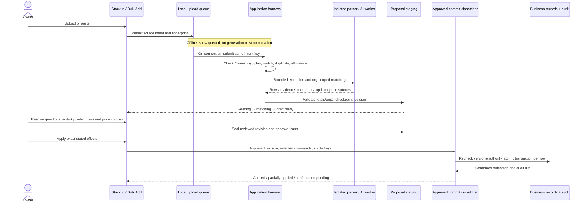
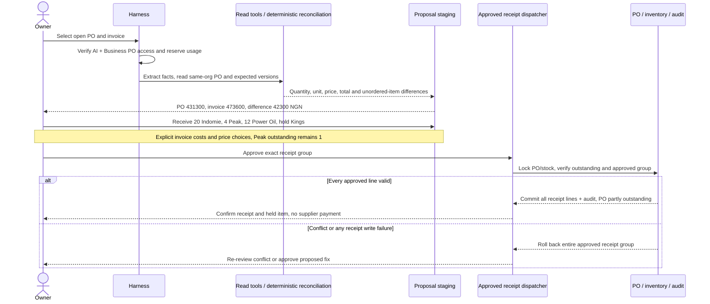
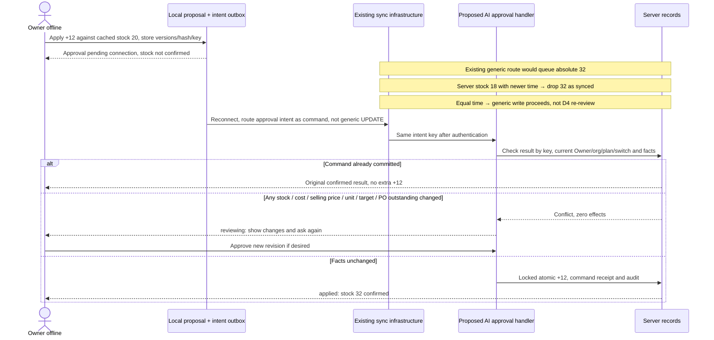
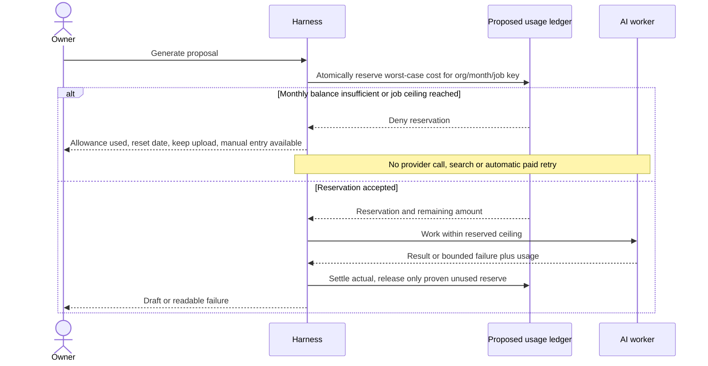
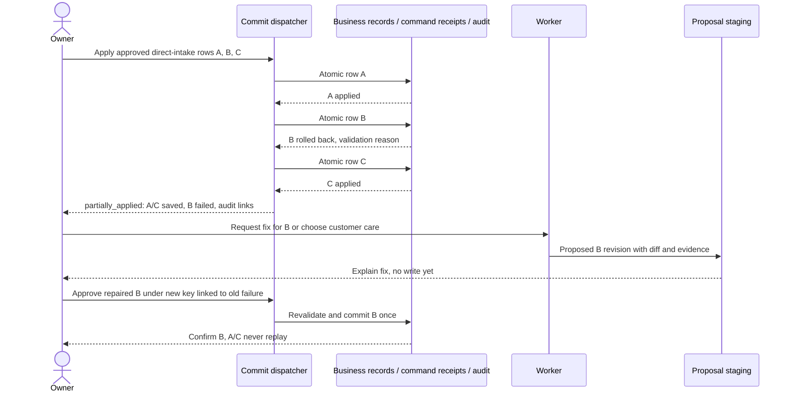

# Core sequences — Gate 1 draft

## One-page summary

All diagrams describe **proposed behavior** unless explicitly labelled existing. The Owner alone approves. Generation requires connectivity and reserved allowance; approval can wait offline, but business success requires server confirmation. Direct intake keeps good rows when others fail (D3); fixes require fresh approval (**assumption**). PO receipt is gated on a safe manual receipt foundation and atomicity confirmation. D4 cannot be implemented by treating the current generic sync success as proof of an applied approval. Diagrams deliberately name logical components rather than inventing endpoints.

Authority: [spec D1–D6 and §6](../track-kasuwa-ai-assistant-spec.md). State names follow [proposal-lifecycle.md](proposal-lifecycle.md). Future contracts follow [agent-design.md](agent-design.md).

## (a) Stock In upload

D6: missing cost becomes ₦0 **with** `cost_needs_update`, reminder and profit exclusion, not a guessed fact. No selected selling-price change means current price stays. Generation persists drafts, not business mutations. Current [assistant](../../../src/app/(dashboard)/assistant/page.tsx) uses in-memory draft state and immediate `/api/ai` approval; the durable queue/review contract is new. Proof: E01–E19/E24–E29.

## (b) Invoice versus PO reconciliation

**Assumption Q04:** receipt group is atomic, not “entire PO must arrive.” Current [receipt loop](../../../src/components/purchase-orders/purchase-orders-screen.tsx) instead adds all ordered quantities and ignores intermediate write errors. [011 schema](../../../supabase/migrations/011_purchase_orders.sql) has item received quantities but no partial parent status. Do not attach reconciliation until foundation exists. Proof: E20–E23.

## (c) Offline approval, reconnect and the real conflict rule

**Verified existing rule:** [sync engine](../../../src/lib/offline/sync-engine.ts), `executeSyncOperation`: generic UPDATE reads `updated_at`; strictly newer server time drops the local write and returns success. Equal timestamps proceed. It is read-then-write, not atomic compare-and-set. Import commands instead use `apply_import_row`; vendor `stock_sync` instead uses exact server-version matching and keeps conflicts/unknown outcomes for review. None currently implements durable AI approval.

**Proposed D4 adaptation:** use command-specific checks, consistent with the existing vendor review pattern, and compare all approved business facts, even if timestamps tie. Preserve current generic behavior for other flows; never silently drop an AI approval or overwrite from its cached snapshot. Existing [PO lifecycle guard](../../../src/lib/offline/purchase-orders.ts) remains online-only until explicitly extended. Proof: E30–E36.

## (d) Allowance exhausted

**Assumption Q03:** hard stop, no overage purchase; viewing and committing existing approved drafts stays available within normal entitlement. Current [016 rate limit](../../../supabase/migrations/016_ai_assistant_plumbing.sql) is per-user count, not D5 allowance. Proof: E42.

## (e) Partial failure and proposed fixes

Fresh approval of fixes is an explicit **D3 assumption**. Customer-care context is previewed/redacted and sent only after Owner choice and a separately approved support-sharing policy; no automatic analytics access (D8). [015](../../../supabase/migrations/015_business_imports.sql) already keeps row results, including errors, immutable; reusing a failed import key returns its old error. Proof: E27–E29/E39.

**Navigation proposal:** back/reload restores the current persisted revision; it never undoes a commit. Unknown writes display confirmation pending until queried. No optimistic financial/stock success screens. These sequences have not been run against a provider, database or native app.
