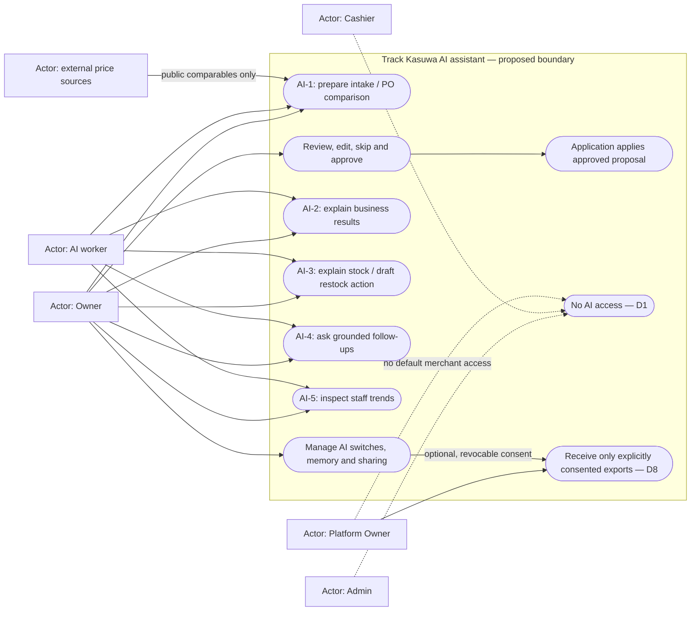

# AI assistant use cases — Gate 1 draft

## One-page summary

Only the **Owner** uses AI (D1). Admins and Cashiers have no upload, proposal, answer, approval or memory access. The AI worker prepares drafts; the application validates and applies approved work. Platform Owner access to merchant outputs is unresolved and denied by default in this proposal. AI-1 comes first; AI-2–AI-5 depend on trustworthy records. This is a planning pack for Boss review, not architecture approval or permission to build. Gate 2 requires a clickable HTML prototype, unaided tasks with Boss and 3–5 real Owners, and a signed cut list. Gate 3 follows that approval.

Authority: [v0.3 spec, D1–D8 and §§5–10](../track-kasuwa-ai-assistant-spec.md). **Verified** below means source inspection on 2026-11-03, not production verification. **Proposed** means a reviewable design. **Assumption** identifies an undecided default. Test IDs refer to [edge-cases.md](edge-cases.md).

## Use case diagram

Mermaid flowchart notation represents actors and use cases; dashed denial links are restrictions, not permissions.

## Use cases

All cases require an active Owner in the current organization, eligible subscription, capability switch and available generation allowance. D2 overrides §6.2's “all plans”: Starter has no AI. **Open:** the catalog also has Free and legacy plans; their allowance and trial treatment need a decision [Q02](open-questions.md). Reading a completed draft or applying already approved work should not consume generation allowance (**proposal**).

| ID | Owner's job / input | Result and approval boundary | Dependencies / proof |
|---|---|---|---|
| AI-1a | Upload/paste invoice, photo, PDF, screenshot, handwriting or spreadsheet at Stock In/Bulk Add | Review existing/new products, quantities, units, warehouse, separate costs/current/suggested prices. Apply selected rows only; no selling-price change without explicit selection | Matching and unit evidence; D6 missing-cost flag; E01–E19, E24–E31 |
| AI-1b | Compare invoice with an open PO | Explain quantity/price/unordered-item differences; approve an explicit receipt proposal | Business+ PO entitlement; safe partial receipt foundation first; E20–E23 |
| AI-1c | Reopen draft, resolve a failed row or approve offline | Resume exact revision; show pending/conflict/confirmed outcomes and audit links | [Lifecycle](proposal-lifecycle.md), [sequences](sequences.md); E24–E36 |
| AI-2 | Request period summary from merchant records | Cited, deterministic figures and comparisons; read-only, no approval needed | Reconciled report definitions and known-cost coverage; E43–E44 |
| AI-3 | Ask what to restock or transfer | Explain sales pace/history; check other warehouses first; draft transfer, PO or restock list | Insufficient history is explicit. Creating any business record needs approval; E45 |
| AI-4 | Ask a question, then a contextual follow-up | Organization-only answer with period, evidence and limitations; optional new action proposal | Bounded conversation context and locale; E40, E43, E47–E48 |
| AI-5 | Inspect staff sales/void/refund/discount trends | Owner-only evidence, no accusations; no efficiency ranking without fair exposure data | Cashier attribution differs from reversal actor; E46 |
| Shared | Review allowance, turn a capability off, edit/delete learned items, grant/revoke sharing | Owner-controlled configuration; delegation policy exists but initially allows Owner only. Sharing stays off by default | D1/D5/D8; no supplier/customer messaging; E37–E41 |

## Verified disagreements and limits

* **D1 is not current behavior.** UI, API context and SQL allow Owner/Admin. Existing job reads check org and requesting user, without a fresh role condition. Removing Admin access needs UI, API, RPC and read-policy changes. Sources: [assistant UI](../../../src/app/(dashboard)/assistant/page.tsx), [API context](../../../src/lib/auth/api-context.ts), [016 AI migration](../../../supabase/migrations/016_ai_assistant_plumbing.sql). The [earlier map](../AI_ASSISTANT_CODEBASE_MAP.md)'s proposed owner/admin phase is superseded by D1.
* **D2 is not current behavior.** [Entitlement](../../../src/lib/ai/entitlement.ts) and migration 016 allow a valid trial or Growth+; no organization capability switches appear in those paths. [010 plan catalog](../../../supabase/migrations/010_five_tier_subscription_plans.sql) includes Free, Starter, Growth, Business and Enterprise.
* **Coverage is partial.** [Current API](../../../src/app/api/ai/route.ts) accepts inventory text or insights; [file parser](../../../src/lib/imports/parse.ts) accepts one CSV/XLSX worksheet. Photos/PDFs, web prices and contextual follow-ups are proposed additions. [Analysis](../../../src/lib/ai/analysis.ts) already calculates limited stock pace and anonymous cashier totals; this is not verified prediction or fair staff efficiency.
* **Parity needs foundation work.** [Stock adjustment](../../../src/lib/inventory/adjust-stock.ts) uses separate stock/movement/audit writes. [PO receipt](../../../src/components/purchase-orders/purchase-orders-screen.tsx) receives ordered quantities in full. AI must not wrap these limitations and claim safe receipt semantics.

**Review boundary:** approve the cases and exclusions at Gate 1. Inward consignment, payroll, billing, autonomous writes and supplier/customer messaging remain outside this pack. Real invoice quality, native behavior and merchant completion time are unverified.
